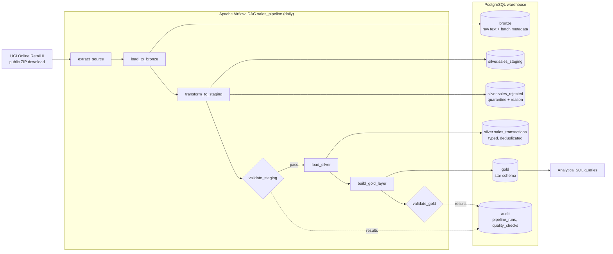
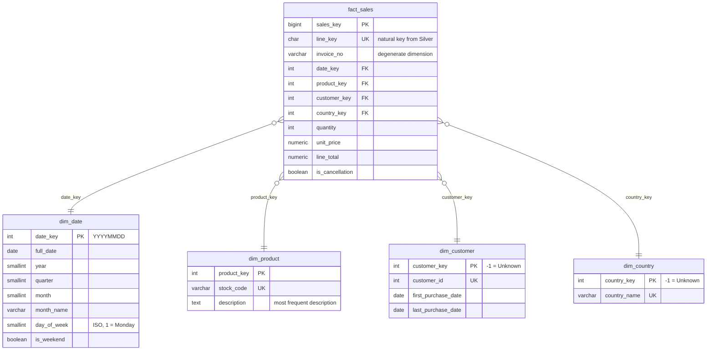

# DataFlow Pipeline

[](https://github.com/luizsoc/dataflow-pipeline/actions/workflows/ci.yml)

A batch data pipeline that turns one million raw retail transactions into a tested, analytics-ready
star schema. It is built with Python, PostgreSQL and Apache Airflow on a Medallion Architecture
(Bronze, Silver, Gold), and runs end to end with a single `docker compose up`.

| Metric (full dataset) | Value |
| --- | --- |
| Raw rows ingested (Bronze) | 1,067,371 |
| Clean rows (Silver) | 1,021,252 (95.7%) |
| Quarantined rows, each with a reason | 46,119 |
| Automated quality checks per run | 13 (11 blocking) |
| Automated tests | 79 |

## Table of Contents

- [Project Overview](#project-overview)
- [Business Problem](#business-problem)
- [Architecture](#architecture)
- [Technology Stack](#technology-stack)
- [Data Source](#data-source)
- [Pipeline Workflow](#pipeline-workflow)
- [Data Quality](#data-quality)
- [Database Modeling](#database-modeling)
- [Installation](#installation)
- [Execution Instructions](#execution-instructions)
- [Testing](#testing)
- [Example SQL Queries](#example-sql-queries)
- [Power BI Dashboard](#power-bi-dashboard)
- [Project Structure](#project-structure)
- [Design Decisions](#design-decisions)
- [Future Improvements](#future-improvements)

## Project Overview

The pipeline downloads a public e-commerce dataset, stores it untouched, cleans and validates it,
and models it as a star schema in PostgreSQL. Apache Airflow orchestrates the seven steps daily.

What it demonstrates:

- **ETL / ELT:** extraction over HTTP, transformation in Pandas (Silver) and in SQL inside the
  database (Gold).
- **Idempotency:** running the pipeline twice produces exactly the same data. The audit table shows
  the second run skipping the known file and changing 0 rows.
- **Data quality as a gate:** critical checks stop the run before invalid data reaches Silver or Gold.
- **Dimensional modeling:** fact and dimension tables, surrogate keys, an unknown member and a
  degenerate dimension.
- **Observability:** structured `key=value` logs, plus every task run and every quality check
  stored in an `audit` schema.

## Business Problem

A UK-based online retailer sells giftware wholesale. Its sales system exports raw invoice lines
that mix real sales with cancellations, postage fees, manual adjustments, zero-price lines and
duplicates. About 23% of lines have no customer ID.

Analysts need trustworthy answers to questions such as:

- How does revenue evolve month by month, and how much is lost to cancellations?
- Which products drive revenue?
- Which countries cancel the most?
- What is the average order value, and who are the most valuable customers?
- How many buyers each month are new, and how many come back?

The pipeline delivers a clean, documented and reconciled dataset that answers these questions with
simple SQL. It also keeps a full trace from every analytical row back to the original file.

## Architecture



**How the layers relate.** Data only moves forward, and each layer reads only from the one before
it, so any layer can be rebuilt from the layer below.

| Layer | Contains | Guarantee |
| --- | --- | --- |
| Raw file | `data/raw/ingestion_date=YYYY-MM-DD/online_retail_ii.zip` | The exact bytes downloaded, identified by SHA-256 |
| Bronze | Every source row as text, with sheet, row number and batch ID | Nothing is lost or altered; every row is traceable to its file |
| Silver | Typed, cleaned, deduplicated sales lines; rejected rows in quarantine | Every row passed the cleaning rules and the critical quality checks |
| Gold | Star schema: `fact_sales` and four dimensions | Reconciled with Silver line by line and in total revenue |

## Technology Stack

| Area | Technology | Used for |
| --- | --- | --- |
| Language | Python 3.12 | Extraction, cleaning, orchestration code |
| Processing | Pandas 3 | Bronze to Silver transformation (~1M rows in memory) |
| Storage | PostgreSQL 16 | Warehouse with constraints, indexes and set-based SQL |
| Orchestration | Apache Airflow 3.3 (LocalExecutor) | Scheduling, dependencies, retries, callbacks |
| Infrastructure | Docker, Docker Compose | Six services, healthchecks, volumes |
| Quality | Pytest, Ruff | Unit and integration tests, PEP 8 linting |

## Data Source

[Online Retail II](https://archive.ics.uci.edu/dataset/502/online+retail+ii), from the UCI Machine
Learning Repository (license CC BY 4.0). It contains all transactions of a UK online retailer
between 01/12/2009 and 09/12/2011, about 1.07 million invoice lines in one Excel workbook with two
sheets.

| Column | Description |
| --- | --- |
| `Invoice` | Invoice number; a `C` prefix marks a cancellation |
| `StockCode` | Product code |
| `Description` | Product name |
| `Quantity` | Units per line; negative for cancellations |
| `InvoiceDate` | Date and time of the invoice |
| `Price` | Unit price in pounds sterling |
| `Customer ID` | Customer number; missing on about 23% of lines |
| `Country` | Customer's country |

It was chosen over the Olist dataset because it downloads without authentication, which makes
extraction fully automatable. Its data quality problems are also real and documented.

## Pipeline Workflow

| # | Task | What it does | Failure handling |
| --- | --- | --- | --- |
| 1 | `extract_source` | Downloads the ZIP into a date partition, writes it atomically, computes SHA-256 | 2 retries for timeouts and 5xx; a 4xx fails at once |
| 2 | `load_to_bronze` | Skips the file if its hash is already loaded; otherwise reads both sheets and bulk-loads them with `COPY` | Batch row and data rows in one transaction |
| 3 | `transform_to_staging` | Reads the batch, applies the cleaning rules, writes clean rows to staging and rejects to quarantine | Staging is truncated each run |
| 4 | `validate_staging` | Runs 9 quality checks on staging and records the results | A critical failure fails the task, with no retry |
| 5 | `load_silver` | Upserts staging into Silver on `line_key`; unchanged rows are not rewritten | Single transaction |
| 6 | `build_gold_layer` | Upserts the four dimensions, then the fact table, in plain SQL | Single transaction |
| 7 | `validate_gold` | Reconciles Gold with Silver (rows, keys, revenue, customers) | A critical failure fails the task, with no retry |

DAG settings: daily schedule, `catchup=False`, `max_active_runs=1`, a 30-minute timeout per task,
and success and failure callbacks that write to `audit.pipeline_runs`. Tasks exchange only small
metadata through XCom (paths, hashes, batch IDs). The data itself moves through PostgreSQL.

### Cleaning rules (Bronze to Silver)

Each row gets the first rule it fails, so every rejected row has exactly one reason.

| Rule | Action | Rows (full dataset) |
| --- | --- | --- |
| Exact duplicate of an earlier line | Quarantine: `duplicate_line` | 34,037 |
| Price zero or negative | Quarantine: `non_positive_price` | 6,207 |
| Stock code is not a product (`POST`, `M`, `BANK CHARGES`, `AMAZONFEE`, ...) | Quarantine: `non_product_code` | 5,875 |
| Missing invoice or stock code; invalid quantity, price or date; future date | Quarantine with the specific reason | 0 |
| Invoice starts with `C` | Kept, `is_cancellation = true`, negative quantity preserved | |
| No customer ID | Kept; linked to the "Unknown" customer in Gold | |
| Text fields | Trimmed, whitespace collapsed, upper-cased; `EIRE` becomes `Ireland`, `Unspecified` becomes `Unknown` | |

## Data Quality

Checks are plain SQL queries that return the number of failing rows. Every result, pass or fail,
is stored in `audit.quality_checks`.

| Check | Layer | Severity |
| --- | --- | --- |
| Staging is not empty | Staging | Critical |
| Required fields are not null | Staging | Critical |
| `line_key` is unique | Staging | Critical |
| Dates between 2009-12-01 and now | Staging | Critical |
| Unit price greater than zero | Staging | Critical |
| Quantity different from zero | Staging | Critical |
| Less than 10% of the batch quarantined | Staging | Critical |
| Cancellations negative, sales positive | Staging | Warning |
| Less than 30% of lines without a customer | Staging | Warning |
| Every Silver line exists in `fact_sales` | Gold | Critical |
| Row count equals Silver | Gold | Critical |
| Total revenue equals Silver | Gold | Critical |
| Lines with a customer ID never point to the unknown customer | Gold | Critical |

## Database Modeling

Four schemas in one PostgreSQL database. The full column reference is in
[docs/data_dictionary.md](docs/data_dictionary.md).

| Schema | Tables |
| --- | --- |
| `bronze` | `ingestion_batches`, `online_retail_raw` |
| `silver` | `sales_staging`, `sales_transactions`, `sales_rejected` |
| `gold` | `fact_sales`, `dim_date`, `dim_product`, `dim_customer`, `dim_country` |
| `audit` | `pipeline_runs`, `quality_checks` |

### Gold star schema

The grain of `fact_sales` is **one invoice line**: one product within one invoice.



Modeling choices:

- **Surrogate keys** in every dimension, with the natural key kept as a `UNIQUE` column.
- **Unknown members** (`-1`) in `dim_customer` and `dim_country`, so the about 23% of sales with no
  customer still count in every total.
- **Country as its own dimension**, not a customer attribute, because sales without a customer
  still have a country.
- **`invoice_no` as a degenerate dimension** on the fact table. An invoice has no attributes of its
  own worth a table.
- **SCD Type 1** for dimensions: attributes are overwritten. The dataset has almost no attribute
  history to keep.
- **Indexes** on every fact foreign key. PostgreSQL does not create them automatically.

## Installation

Requirements: Docker Desktop (or Docker Engine) with Compose v2, Git, and at least 4 GB of RAM
available to Docker.

```bash
git clone <repository-url> dataflow-pipeline
cd dataflow-pipeline
```

Create the `.env` file with random secrets.

On Windows:

```powershell
powershell -ExecutionPolicy Bypass -File scripts\generate-env.ps1
```

On Linux or macOS, copy `.env.example` to `.env` and replace every `change-me` value. The comments
in the file show how to generate each secret.

`.env` is listed in `.gitignore` and must never be committed.

## Execution Instructions

```bash
docker compose up -d --build   # first build takes a few minutes
docker compose ps              # wait until every service is "healthy"
```

1. Open the Airflow UI at <http://localhost:8080>. The user and password are `AIRFLOW_ADMIN_USER`
   and `AIRFLOW_ADMIN_PASSWORD` in `.env`.
2. Enable the `sales_pipeline` DAG and click **Trigger**. A full first run takes a few minutes.
3. Query the warehouse at `localhost:5433` with any SQL client, or through the container:

```bash
docker compose exec postgres-dw psql -U dataflow -d dataflow
```

Useful commands:

| Goal | Command |
| --- | --- |
| Follow scheduler logs | `docker compose logs -f airflow-scheduler` |
| Last task runs | `SELECT * FROM audit.pipeline_runs ORDER BY run_step_id DESC LIMIT 10;` |
| Last quality checks | `SELECT * FROM audit.quality_checks ORDER BY check_id DESC LIMIT 13;` |
| Run from another URL (e.g. a mirror) | Trigger the DAG with the `source_url` parameter |
| Stop everything | `docker compose down` |
| Reset all data | `docker compose down -v` (deletes the volumes) |

## Testing

Tests run inside the Airflow container, with the same Python and libraries as the pipeline:

```bash
docker compose exec airflow-scheduler pytest                  # all tests
docker compose exec airflow-scheduler pytest tests/unit       # fast, no database
docker compose exec airflow-scheduler pytest -m integration   # against the warehouse
docker compose exec airflow-scheduler ruff check src dags tests
```

| Suite | What it covers |
| --- | --- |
| `tests/unit` | Configuration, download (atomic write, retryable errors), Excel reading, every cleaning rule, quality check logic, audit records |
| `tests/integration` | Schema and constraints, Bronze load and idempotency, Silver load, the quality gate stopping invalid data, Gold build and reconciliation, every analytical query |
| `tests/test_dag_integrity.py` | The DAG imports without errors |

Integration tests run inside a transaction that is rolled back, so they never change the warehouse.

### Continuous Integration

[GitHub Actions](.github/workflows/ci.yml) runs on every push to `main` and on every pull request:

| Job | Steps |
| --- | --- |
| Lint and format | `ruff check` and `ruff format --check` |
| Tests | Starts a PostgreSQL 16 service, applies `sql/init/`, installs Airflow 3.3.2 with its official constraints, runs the full `pytest` suite |

In CI the warehouse starts empty, so all 79 tests run, including the Gold layer tests.
The Gold tests compare whole tables, so they only run when the warehouse is empty and are skipped
otherwise. On a warehouse with data the expected result is 69 passed, 10 skipped.

## Example SQL Queries

All five queries are in [`sql/analytics/`](sql/analytics). Run one with:

```bash
docker compose exec -T postgres-dw psql -U dataflow -d dataflow < sql/analytics/01_monthly_revenue.sql
```

On Windows PowerShell, pipe the file instead:
`Get-Content sql\analytics\01_monthly_revenue.sql | docker compose exec -T postgres-dw psql -U dataflow -d dataflow`

**Monthly revenue with growth** (`01_monthly_revenue.sql`, window function `LAG`):

```sql
WITH monthly AS (
    SELECT d.year, d.month,
           SUM(f.line_total) FILTER (WHERE NOT f.is_cancellation) AS gross_revenue,
           SUM(f.line_total) FILTER (WHERE f.is_cancellation)     AS cancelled_revenue,
           SUM(f.line_total)                                      AS net_revenue
    FROM gold.fact_sales AS f
    JOIN gold.dim_date AS d ON d.date_key = f.date_key
    GROUP BY d.year, d.month
)
SELECT year, month, gross_revenue, cancelled_revenue, net_revenue,
       ROUND(100.0 * (net_revenue - LAG(net_revenue) OVER w)
             / NULLIF(LAG(net_revenue) OVER w, 0), 1) AS net_growth_pct
FROM monthly
WINDOW w AS (ORDER BY year, month)
ORDER BY year, month;
```

Selected rows of the result (amounts in GBP):

| year | month | gross_revenue | cancelled_revenue | net_revenue | net_growth_pct |
| --- | --- | --- | --- | --- | --- |
| 2010 | 9 | 869,243.12 | -27,686.42 | 841,556.70 | 27.2 |
| 2010 | 10 | 1,094,435.98 | -25,451.07 | 1,068,984.91 | 27.0 |
| 2010 | 11 | 1,429,700.78 | -35,098.98 | 1,394,601.80 | 30.5 |
| 2011 | 11 | 1,451,578.98 | -24,991.44 | 1,426,587.54 | 34.4 |
| 2011 | 12 | 614,490.92 | -174,091.36 | 440,399.56 | -69.1 |

Revenue peaks every November with Christmas wholesale orders. December 2011 is incomplete (the
data ends on 9 December), and most of its cancelled revenue comes from a single very large order
that was cancelled straight away. This is why gross and net revenue are reported separately.

**Top products by revenue** (`02_top_products.sql`, window functions `RANK` and `SUM OVER`):

| revenue_rank | stock_code | description | units_sold | net_revenue | revenue_share_pct |
| --- | --- | --- | --- | --- | --- |
| 1 | 22423 | REGENCY CAKESTAND 3 TIER | 25,028 | 314,045.02 | 1.66 |
| 2 | 85123A | WHITE HANGING HEART T-LIGHT HOLDER | 91,082 | 251,781.63 | 1.33 |
| 3 | 85099B | JUMBO BAG RED RETROSPOT | 95,963 | 180,512.16 | 0.95 |

Other queries:

| File | Question | SQL techniques |
| --- | --- | --- |
| `03_cancellation_rate_by_country.sql` | Share of invoices cancelled per country | `COUNT DISTINCT ... FILTER`, `HAVING` |
| `04_average_order_value.sql` | Average order value and lifetime revenue per customer | Chained CTEs, `NTILE` deciles |
| `05_new_vs_returning_customers.sql` | New versus returning buyers per month | CTEs, first-purchase month, conditional counts |

## Power BI Dashboard

A four-page Power BI report on the Gold layer lives in [`powerbi/`](powerbi), saved as a
Power BI Project (`.pbip`): the semantic model is TMDL and the report is PBIR, so every
measure, relationship and visual is plain text and reviewable in Git. No data is committed;
it is imported from the warehouse on refresh.

- **Pages:** Overview (KPIs and monthly revenue), Products, Countries, Customers (new vs returning).
- **Model:** the Gold star schema as-is, one-to-many relationships, `dim_date` marked as the date table, import mode.
- **Measures:** 19 DAX measures (gross, cancelled and net revenue, cancellation rate, month-over-month growth, orders, average order value, new and returning customers). Each one follows the same rule as a query in `sql/analytics`, so the numbers can be checked against SQL.

Open `powerbi/DataFlowSales.pbip` in Power BI Desktop, click **Refresh** and sign in with
`DW_USER` / `DW_PASSWORD` from `.env` (server `localhost:5433`). Details in
[`powerbi/README.md`](powerbi/README.md) (Portuguese).

## Project Structure

```
dags/sales_pipeline.py      Airflow DAG: orchestration only, no business logic
src/dataflow/
  config.py                 Settings from environment variables (fails fast if missing)
  logging_config.py         Structured key=value logging
  extraction/               Download with atomic write and SHA-256; Excel reader
  transformation/           Cleaning rules (Pandas) and Gold builder (SQL runner)
  validation/               Quality checks with severity
  loading/                  Bronze COPY loader; staging, quarantine and Silver merge
  database/                 Connection handling, SQL file loader, audit records
sql/init/                   Warehouse DDL, applied automatically on first start
sql/silver/                 Staging to Silver upsert
sql/gold/                   Dimension and fact upserts
sql/analytics/              Example analytical queries
tests/unit/                 Fast tests, no database
tests/integration/          Tests against PostgreSQL, rolled back
docs/                       Data dictionary and architecture decisions
powerbi/                    Power BI project (TMDL model + PBIR report) on the Gold layer
scripts/generate-env.ps1    Creates .env with random secrets on Windows
```

## Design Decisions

The main decisions and the alternatives considered are in
[docs/architecture.md](docs/architecture.md). In short:

- **Pandas, not Spark:** one million rows fit in memory; cleaning took about 11 seconds on 1M rows in a local benchmark.
- **SQL for Gold:** set-based operations run where the data lives.
- **A staging table between tasks**, not XCom: XCom is meant for small metadata.
- **Upsert on natural keys**, not truncate and reload: idempotent, and surrogate keys stay stable.
- **Custom SQL checks**, not Great Expectations: fewer dependencies, and every check fits on one screen.

## Future Improvements

- Incremental, month-partitioned loads instead of reprocessing the whole batch.
- SCD Type 2 on `dim_customer` to keep the history of attribute changes.
- dbt for the Gold layer, with its tests and lineage documentation.
- Parquet in object storage (S3) and Spark for much larger volumes.
- Publish the Power BI report to the Power BI service with scheduled refresh.
